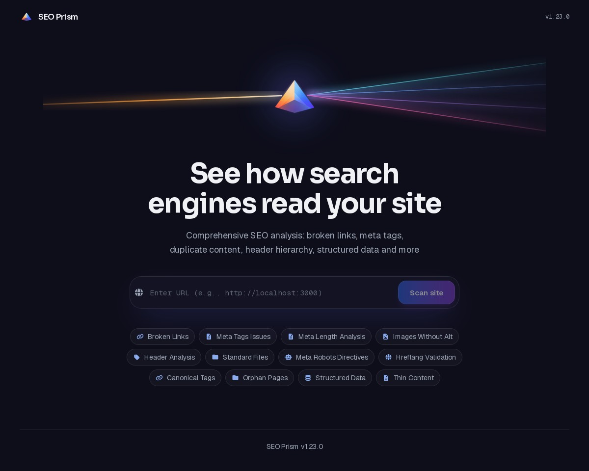

# SEO Prism

A comprehensive technical SEO analyzer that crawls websites to detect and report a wide range of SEO issues. Features advanced analysis of broken links, meta tags, header hierarchy, canonical and hreflang validation, structured data detection, orphan pages, thin content, and standard file compliance (robots.txt, sitemaps, security.txt, llms.txt). Crawls politely: remote targets respect robots.txt (including Crawl-delay) and a notice is emitted when a site looks JavaScript-rendered (SPA).

Provides fair logarithmic SEO grading (A-F), bilingual executive PDF reports with white-label branding, a premium dark crystal web panel with scan history and CSV export, CLI with JSON output for AI agents, a Model Context Protocol (MCP) server for seamless integration with AI development environments, and a single-container Docker deployment.

## Web Interface

SEO Prism features a modern web interface that you can use from any browser. When running the project locally, you also have access to the command-line interface (CLI), which includes all the web interface functionality with faster, more direct performance. Additionally, AI agents can use SEO Prism through its MCP server, allowing you to delegate SEO analysis tasks to your favorite AI agent.



## Features

- ✅ Accepts any URL (localhost, production, custom ports)
- ✅ Detects broken links and resources (HTTP status ≥ 400)
- ✅ Validates missing meta-tags (`<title>`, `<meta name="description">`)
- ✅ Detects duplicate content (titles, descriptions and H1 headers)
- ✅ Analyzes H1 headers (missing, multiple, duplicate)
- ✅ Validates header hierarchy (proper H1-H6 structure)
- ✅ Checks image alt text (missing, short alt tags)
- ✅ Validates standard files: robots.txt, security.txt (both locations), llms.txt and sitemaps (14 documented name scenarios including Astro `sitemap-index.xml`, WordPress `wp-sitemap.xml` and `.well-known/sitemap.xml`, plus the `Sitemap:` directive in robots.txt)
- ✅ Analyzes meta robots directives (noindex, nofollow, nosnippet, etc.)
- ✅ Validates canonical tags (missing, empty, chains, 404s, redirects, URL variations)
- ✅ Validates hreflang tags (invalid/duplicate codes, missing return links, x-default)
- ✅ Analyzes structured data (JSON-LD, Microdata, RDFa)
- ✅ Detects orphan pages and thin content; validates title/meta description lengths
- ✅ Fair SEO grading (A-F) with a logarithmic error-density scale: same error density gives the same score regardless of site size
- ✅ Premium prism-themed web panel (dark crystal UI, Tailwind CSS v4)
- ✅ Bilingual UI (EN/ES): the web panel auto-detects the browser language (Spanish for `es-*`, English otherwise)
- ✅ CLI with full untruncated output and `--json` mode for AI agents
- ✅ MCP server (`seo_scan` tool) + agent skill for AI agents (Hermes Agent, Claude Code, Codex, Devin, OpenClaw)
- ✅ Executive SEO report in PDF (Spanish/English, zero truncation, print-ready)
- ✅ White-label reports: `--brand-name`, `--brand-color` and `--brand-logo` put your own brand on the PDF/PowerPoint cover, headers and footers
- ✅ robots.txt respected by default for remote targets (per-host rules, Crawl-delay/Request-rate pacing, skipped-URL counter); local URLs skip it for speed and `--ignore-robots` overrides it
- ✅ SPA notice: a single low-severity warning when the site looks JavaScript-rendered, instead of a cascade of misleading "missing title" issues
- ✅ Scan history (`GET /scans`) in the web panel — reopen any previous report — and CSV export of every issue section
- ✅ Full potential, no artificial limits: every feature above ships in the open-source edition and `--max-pages` has no hard cap

## Open source, full potential

Everything in this README is part of the open-source edition: no page caps, no pro tiers, no feature gating. Operators who host the tool for other people can optionally add their own guards through environment variables (see [backend/README.md](backend/README.md)), but out of the box nothing is restricted. The only paid thing in this project is the annual commercial license — an AGPL exemption for organizations that need to keep their modifications private, paid by international bank transfer. See [COMMERCIAL-LICENSE.md](COMMERCIAL-LICENSE.md) for plans and purchase flow.

## SEO Grading

Each issue is weighted by severity (high ×3, medium ×1, low ×0.5) and divided by the number of
crawled pages to get the error density `d`. The score uses a logarithmic penalty
(`100 · (1 − log10(1+d) / log10(1+10))`), so a small site with many errors always scores worse
than a large site with fewer, two sites with the same error density get exactly the same score,
and the scale keeps discriminating beyond the point where a linear one would collapse to F.
The letter (A ≥ 90, B ≥ 80, C ≥ 70, D ≥ 60, F below) is derived from the rounded score.

## Installation

### Backend (Python)

```bash
cd backend
python3 -m venv venv
source venv/bin/activate
pip install -r requirements.txt
```

### Frontend (React)

```bash
cd frontend
pnpm install
cp .env.example .env
```

## Usage

### Quickstart with Docker

From the repository root:

```bash
docker compose up --build
```

A single container serves the API and the compiled web panel at `http://localhost:8000` (the panel is at `/index.html`; the API-info endpoint keeps precedence at `/`). Scan history lives in `/app/scans.db` — to keep it across container recreation, create the file on the host (`touch scans.db`) and uncomment the `volumes` block in [`docker-compose.yml`](docker-compose.yml). If you reach the container from another host, rebuild with `docker compose build --build-arg VITE_API_BASE_URL=https://seo.example.com` so the panel is built with the right API origin.

### Start Backend API

```bash
cd backend
source venv/bin/activate
python -m api.main
```

API will be available at `http://localhost:8000`

Set `CORS_ORIGINS` (comma-separated) to allow other frontend origins —
defaults to `http://localhost:5173`:

```bash
CORS_ORIGINS=https://app.example.com python -m api.main
```

**Environment variables (all optional, for deployments):**

| Variable | Default | Purpose |
|---|---|---|
| `CORS_ORIGINS` | `http://localhost:5173` | Comma-separated origins accepted by the API's CORS middleware. |
| `SEO_PRISM_MAX_PAGES_LIMIT` | unset — **no cap** | Optional operator guard: upper bound on the `max_pages` requested per scan (HTTP API and MCP server). The open-source edition ships with no ceiling; set it (e.g. `100`) only when you host the tool for others. An invalid or non-positive value is ignored with a logged warning. |
| `SEO_PRISM_API_KEY` | unset — API open | When set, every endpoint except `/health` requires the key in an `X-API-Key` request header; a missing or wrong key gets `401`. The bundled panel asks for the key on a 401, keeps it in `sessionStorage` and sends it with every request; it is never baked into the build. |
| `SEO_PRISM_BLOCK_PRIVATE_TARGETS` | unset — disabled | Set to `1` to reject any host that resolves to a loopback, private, link-local, CGNAT or reserved address (including `169.254.169.254`). It is enforced on the scan target and on every redirect, external resource, robots.txt and standard-file request, in the HTTP API, MCP server and CLI; the aiohttp connector validates each connection, including IP literals. It validates at connect time rather than pinning a separate DNS lookup, so a residual DNS-rebinding window remains. Leave unset for local development, where scanning `localhost` is the intended use. |
| `SEO_PRISM_STATIC_DIR` | unset — API only | Directory containing the compiled frontend; when set, the API serves it at `/` while keeping every API route reachable. The Docker image sets it to `/app/static`. |

The full deployment reference (Docker persistence, public-deployment examples) is in [backend/README.md](backend/README.md).

### Start Frontend

```bash
cd frontend
pnpm dev
```

Frontend will be available at `http://localhost:5173`

### CLI Usage

```bash
cd backend
source venv/bin/activate
python cli.py --url http://localhost:3000
python cli.py --url https://example.com --max-pages 50
python cli.py --url https://example.com --max-pages 500   # no hard cap: any larger value is honored
python cli.py --url https://example.com --ignore-robots   # override robots.txt for a remote target
```

### JSON Output (`--json`)

Add `--json` to get the complete analysis in a single machine-readable document (ideal for AI agents or piping to `jq`). Progress messages go to `stderr` and `stdout` contains ONLY the JSON payload with the keys `scan`, `issues` (every issue, untruncated), `seo_grade` and `resource_analysis`; page HTML is excluded to keep the output compact.

```bash
python cli.py --url https://example.com --json > scan_results.json
python cli.py --url https://example.com --json 2>/dev/null | jq '.issues | length'
```

A target that cannot produce a valid HTML page (unreachable host, timeout, 4xx/5xx root, non-HTML target or a root blocked by robots.txt) is neither graded nor stored in history. The CLI exits with code `1` and, in `--json` mode, writes a single `{"error": "..."}` object to stdout (progress and the human-readable error go to stderr). Successful scans exit `0`.

### Generate Professional SEO Report

Generate a professional executive SEO report. The default format is **PDF** (complete, print-ready, every issue listed with automatic pagination — no manual adjustments needed). Reports are fully bilingual (`--lang es|en`): category labels, issue descriptions and section texts are all translated. The legacy PowerPoint format is still available as an editable option. Both formats are white-label: your brand name, accent color and logo replace SEO Prism's on the cover, headers and footers.

```bash
cd backend
source venv/bin/activate
python cli.py --url <URL> --generate-report                       # PDF (default)
python cli.py --url <URL> --generate-report --report-format pptx  # editable PowerPoint
```

**Available options:**

- `--url` (required): Target URL to scan
- `--max-pages` (optional, default 100, minimum 1): Maximum number of pages to crawl (no hard cap: any larger value is honored)
- `--ignore-robots` (flag): Ignore robots.txt even for remote URLs (local URLs are always scanned without robots.txt)
- `--json` (flag): Print complete scan results as JSON to stdout (progress goes to stderr)
- `--generate-report` (flag): Enable report generation
- `--report-format` (optional, default `pdf`): `pdf` or `pptx`
- `--lang` (optional, default 'en'): Report language - 'es' for Spanish, 'en' for English
- `--output` (optional): Output file path (default: `seo_report.pdf` or `seo_report.pptx` per format)
- `--brand-name` (optional, default `SEO Prism`): Brand name shown on the report cover, headers and footers
- `--brand-color` (optional): Brand accent color as hex (e.g. `#9333EA`); malformed values fall back to the default palette
- `--brand-logo` (optional): Path to a logo image embedded on the report cover (ignored when the file does not exist)

**Examples:**

```bash
# Generate PDF report in Spanish
python cli.py --url https://example.com --generate-report --lang es --output reporte_seo.pdf

# Generate report in English (default PDF)
python cli.py --url https://example.com --generate-report

# Editable PowerPoint version
python cli.py --url https://example.com --generate-report --report-format pptx

# White-label PDF with your own brand
python cli.py --url https://example.com --generate-report --brand-name "Acme" --brand-color "#9333EA" --brand-logo acme.png

# With page limit and Spanish report
python cli.py --url http://localhost:3000 --max-pages 50 --generate-report --lang es
```

## MCP Server (AI Agents)

`backend/mcp_server.py` wraps the scan pipeline as a [Model Context Protocol](https://modelcontextprotocol.io) server. It exposes one tool, `seo_scan(url, max_pages)`, returning `{scan, issues, seo_grade, resource_analysis}` — the same payload as `cli.py --json`.

```bash
cd backend
source venv/bin/activate      # or: pip install -r requirements.txt
python mcp_server.py          # stdio transport (what agents launch)

# Optional HTTP transport for remote clients:
python mcp_server.py --transport streamable-http --port 8080
```

Register the server in your agent, replacing `/path/to/seo-prism/backend` with the real path (use the venv python so dependencies resolve):

**Hermes Agent** — `~/.hermes/config.yaml`:

```yaml
mcp_servers:
  seo-prism:
    command: "/path/to/seo-prism/backend/venv/bin/python"
    args: ["/path/to/seo-prism/backend/mcp_server.py"]
    cwd: "/path/to/seo-prism/backend"
```

**Claude Code** — from the repo root:

```bash
claude mcp add seo-prism -- /path/to/seo-prism/backend/venv/bin/python /path/to/seo-prism/backend/mcp_server.py
```

**Codex** — `~/.codex/config.toml`:

```toml
[mcp_servers.seo-prism]
command = "/path/to/seo-prism/backend/venv/bin/python"
args = ["/path/to/seo-prism/backend/mcp_server.py"]
```

**Devin** — Settings → MCP servers → custom server, STDIO transport, same command/args as above.

**OpenClaw** — config (`mcp.servers`) or `openclaw mcp add`:

```json5
{
  mcp: {
    servers: {
      seo-prism: {
        command: "/path/to/seo-prism/backend/venv/bin/python",
        args: ["/path/to/seo-prism/backend/mcp_server.py"],
      },
    },
  },
}
```

Agents that can run shells don't need MCP: `cli.py --json` works directly — see `skills/seo-prism/SKILL.md` for a ready-made agent skill.

## API Endpoints

- `GET /` - API info
- `POST /scan` - Start a new scan. Returns `400` for an invalid URL or a target blocked by robots.txt, and `502` when the target is unreachable; failed targets are not stored in history
- `GET /scans` - List recent scans (id, URL, date, grade and issue count per scan)
- `GET /results` - Get latest scan results
- `GET /results/{scan_id}` - Get specific scan results
- `GET /health` - Liveness probe (no authentication)

When `SEO_PRISM_API_KEY` is set, every endpoint except `/health` requires the key in an `X-API-Key` request header. The bundled web panel reacts to a `401` by opening an API-key field (stored only in that browser tab's `sessionStorage`); the key is not part of the compiled bundle. The Docker healthcheck probes `/health`, which stays unauthenticated.

## Testing

The backend pytest suite covers every analysis module, the CLI, both report
generators, the grading fairness guarantees, the standard-file discovery scenarios
(integration tests with a real HTTP server), robots.txt compliance, SPA detection
and the SSRF network guard.

```bash
cd backend
venv/bin/pytest
```

The frontend has its own suite (Vitest + Testing Library): the full scan flow
against a mocked API, error states, both languages, every report section, and a
guard that fails when the backend emits an issue type that no section displays.

```bash
cd frontend
pnpm test      # unit + component tests
pnpm check     # type check
pnpm build     # type check + production build
```

Continuous integration (`.github/workflows/ci.yml`) runs the backend pytest
suite and the frontend test, type-check and build steps on every push and
pull request to `main`.

## Project Structure

```
seo-prism/
├── backend/
│   ├── core/
│   │   ├── crawler.py
│   │   ├── net_guard.py
│   │   ├── pipeline.py
│   │   ├── robots.py
│   │   ├── soup.py
│   │   └── url_utils.py
│   ├── modules/
│   │   ├── broken_links.py
│   │   ├── canonical_tags.py
│   │   ├── duplicate_content.py
│   │   ├── header_hierarchy.py
│   │   ├── hreflang.py
│   │   ├── image_alt_text.py
│   │   ├── meta_length.py
│   │   ├── meta_robots.py
│   │   ├── meta_tags.py
│   │   ├── orphan_pages.py
│   │   ├── resource_analyzer.py
│   │   ├── seo_grade.py
│   │   ├── spa_detection.py
│   │   ├── standard_files.py
│   │   ├── structured_data.py
│   │   ├── thin_content.py
│   │   ├── pdf_report_generator.py
│   │   ├── report_generator.py
│   │   ├── report_translations.py
│   │   └── description_translations.py
│   ├── api/
│   │   └── main.py
│   ├── tests/
│   ├── cli.py
│   ├── limits.py
│   ├── mcp_server.py
│   ├── database.py
│   ├── version.py
│   ├── README.md
│   ├── requirements.txt
│   └── pyproject.toml
├── skills/
│   └── seo-prism/
│       └── SKILL.md
├── frontend/
│   ├── src/
│   │   ├── components/
│   │   │   ├── sections/
│   │   │   └── ui/
│   │   ├── hooks/
│   │   │   ├── usePagination.ts
│   │   │   └── useScanHistory.ts
│   │   ├── i18n/
│   │   │   ├── en.ts
│   │   │   ├── es.ts
│   │   │   └── index.tsx
│   │   ├── lib/
│   │   ├── App.tsx
│   │   ├── index.css
│   │   ├── issueMeta.tsx
│   │   ├── filters.ts
│   │   ├── types.ts
│   │   ├── types_scans.ts
│   │   └── version.ts
│   ├── .env.example
│   ├── package.json
│   ├── tsconfig.json
│   └── vite.config.ts
├── .github/
│   └── workflows/
│       └── ci.yml
├── Dockerfile
├── docker-compose.yml
├── LICENSE
└── README.md
```

## Promotional Video


## Support the project

**Sponsor on GitHub**
You can [sponsor me on GitHub](https://github.com/sponsors/mykeura). It helps cover development time and the API usage behind ongoing maintenance.

**Nous Portal referral (optional)**
If you are considering the Nous Portal **Plus** plan, you can use [my referral link](https://portal.nousresearch.com/r/mykeura). Your first month costs **$5 instead of $20**, and I receive a $10 referral credit that helps cover the API usage behind my work on SEO Prism. It costs you nothing extra.

*The offer is for new customers starting a new Plus subscription. It applies to the first invoice, and each payment card can be used for only one referral. If the card has already backed another referral, the discount is reversed and no referral reward is paid.*

Using SEO Prism for your company and need a commercial license? See [COMMERCIAL-LICENSE.md](COMMERCIAL-LICENSE.md). It is an annual AGPL-exemption subscription, paid **by international bank transfer only** (email the author, receive an invoice with payment details, pay, and receive the signed PDF license).

## License

SEO Prism is dual-licensed:

- **AGPL-3.0-only** ([LICENSE](LICENSE)): Free and open source. Every source file carries an `SPDX-License-Identifier` header. The open-source edition offers its full potential — no caps, no gating; the optional operator guards above are off by default. The network-use clause means anyone offering SEO Prism as a hosted service must publish their modified source.

- **LicenseRef-SEO-Prism-Commercial** ([COMMERCIAL-LICENSE.md](COMMERCIAL-LICENSE.md)): Annual subscription to an AGPL exemption for organizations that need to keep their modifications private. It unlocks nothing — there are no features behind it — and it is paid by international bank transfer.
